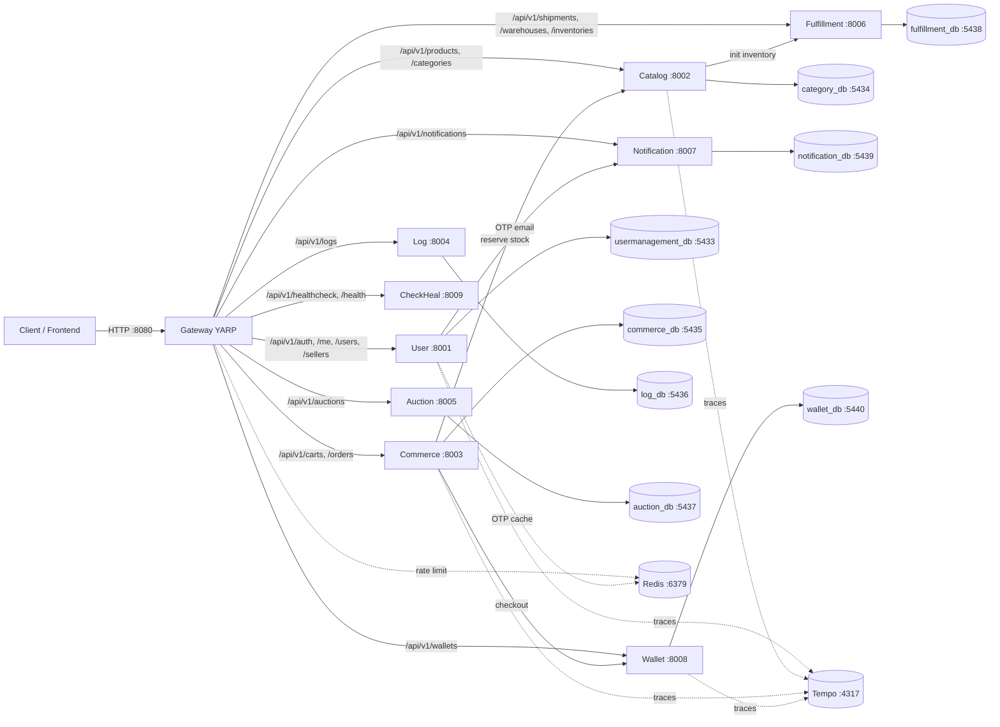

# HƯỚNG DẪN KẾT NỐI DỊCH VỤ TOÀN HỆ THỐNG
## (NEXUS SERVICE CONNECTIVITY GUIDE — LOCAL, DOCKER & MULTI-HOST)

> **Trạng thái triển khai (2026-10-31):** ✅ Đã chuẩn hóa giao tiếp 100% RESTful HTTP/JSON. Message broker, Saga và gRPC đã bị gỡ bỏ. Internal API đang **tạm khóa** theo quy định ngày 2026-10-31; các service gọi nhau bằng route công khai.
> **Nguồn sự thật:** `src/Services/Gateway/Gateway/appsettings.json`, `docker-compose.yml`, `docker-compose.infra.yml`, `src/Services/*/DependencyInjection.cs`, `src/Services/*/Properties/launchSettings.json`, `specs/01_SERVICE_CATALOG_PORT_MAP.md`.
> **Cập nhật lần cuối:** 2026-10-31.

Tài liệu này trả lời một câu hỏi duy nhất: **service A cần làm gì để gọi được service B, và cần cấu hình gì khi A và B không nằm trên cùng một máy chủ.**

---

## 1. MÔ HÌNH TƯ DUY

### 1.1. Vị trí Git repo không quyết định kết nối

Một service là một process hoặc container đang chạy, có địa chỉ mạng riêng. Git repo chỉ là nơi chứa mã nguồn. Hai service nằm chung một repo nhưng chạy trong hai container khác nhau vẫn phải gọi nhau qua HTTP. Hai repo nằm trên hai máy chủ khác nhau cũng gọi nhau qua HTTP, chỉ khác địa chỉ và đường mạng.

### 1.2. Bốn thứ A phải biết về B

1. **Địa chỉ**: hostname hoặc IP, cùng port của B.
2. **Đường dẫn và hợp đồng dữ liệu**: method, route, DTO request/response.
3. **Cách xác thực**: JWT, header danh tính, hoặc không cần.
4. **Cách xử lý khi B chậm hoặc chết**: timeout, retry, idempotency, bù trừ.

### 1.3. Ba quy tắc bất biến

- A không kết nối database của B. Mỗi service sở hữu database riêng trong dải `5433`-`5440`.
- A không đọc file cấu hình nội bộ của B. Mọi thứ đi qua HTTP.
- Không có message broker, Saga hay Outbox. Giao tiếp là đồng bộ và lỗi phải được xử lý ngay tại nơi gọi.

---

## 2. TOPOLOGY TỔNG QUAN



---

## 3. BẢN ĐỒ PORT VÀ DATABASE

| Service | HTTP | Database | DB port | Ghi chú |
|:---|:---:|:---|:---:|:---|
| Gateway (YARP) | `8080` | Không có | — | Edge proxy, stateless |
| User | `8001` | `usermanagement_db` | `5433` | Dùng Redis cho OTP |
| Catalog | `8002` | `category_db` | `5434` | |
| Commerce | `8003` | `commerce_db` | `5435` | Gọi Wallet và Catalog |
| Log | `8004` | `log_db` | `5436` | Nhận batch log |
| Auction | `8005` | `auction_db` | `5437` | |
| Fulfillment | `8006` | `fulfillment_db` | `5438` | Nhận khởi tạo tồn kho |
| Notification | `8007` | `notification_db` | `5439` | Nhận gửi email OTP |
| Wallet | `8008` | `wallet_db` | `5440` | Nhận checkout |
| CheckHeal | `8009` | Không có DB riêng | — | Probe service và DB bên ngoài |

Hạ tầng dùng chung:

- Redis `6379`, chỉ khai báo trong `docker-compose.infra.yml`.
- Tempo OTLP gRPC `4317`, HTTP `4318`, UI `3200`.
- Prometheus `9090`, Grafana `3000`.

Tất cả `launchSettings.json` hiện khớp dải port trên. Khi chạy `dotnet run`, service dùng đúng port trong launch profile.

---

## 4. BẢN ĐỒ ROUTE CỦA GATEWAY

Gateway chuyển tiếp theo tiền tố, lấy từ `src/Services/Gateway/Gateway/appsettings.json`.

| Tiền tố công khai | Cluster | Service đích |
|:---|:---|:---|
| `/api/v1/auth/**`, `/api/v1/me/**`, `/api/v1/users/**`, `/api/v1/sellers/**` | `user-cluster` | User `8001` |
| `/api/v1/admin/users/**`, `/api/v1/admin/roles/**`, `/api/v1/admin/seller-registrations/**` | `user-cluster` | User `8001` |
| `/api/v1/products/**`, `/api/v1/categories/**` | `catalog-cluster` | Catalog `8002` |
| `/api/v1/carts/**`, `/api/v1/orders/**` | `commerce-cluster` | Commerce `8003` |
| `/api/v1/logs/**` | `log-cluster` | Log `8004` |
| `/api/v1/auctions/**` | `auction-cluster` | Auction `8005` |
| `/api/v1/shipments/**`, `/api/v1/warehouses/**`, `/api/v1/inventories/**` | `fulfillment-cluster` | Fulfillment `8006` |
| `/api/v1/notifications/**`, `/api/v1/admin/notifications/**`, `/api/v1/admin/health/**` | `notification-cluster` | Notification `8007` |
| `/api/v1/wallets/**`, `/api/v1/admin/wallets/**` | `wallet-cluster` | Wallet `8008` |
| `/api/v1/healthcheck/**`, `/health/**` | `checkheal-cluster` | CheckHeal `8009` |

### 4.1. Route chưa có trong cấu hình Gateway

Các route sau tồn tại trong controller nhưng chưa có route YARP tương ứng. Gọi qua Gateway sẽ trả `404`:

- `/api/v1/checkouts/**` (Commerce).
- `/api/v1/sub-orders/**` (Commerce).
- `/api/v1/variants/**` (Catalog).
- `/api/v1/admin/auctions/**` (Auction).
- `/api/v1/bids/**` (Auction, ngoài `/api/v1/auctions/{id}/bids`).
- `/api/v1/reviews/**`, `/api/v1/reports/**` (User).

Nếu frontend cần các route này, phải bổ sung route vào `appsettings.json` của Gateway trước khi gọi.

---

## 5. MA TRẬN GỌI LIÊN SERVICE

Đây là các lời gọi đang tồn tại trong code, không phải danh sách mong muốn.

| Caller | Callee | Method và path | Biến cấu hình | Timeout | Ghi chú |
|:---|:---|:---|:---|:---:|:---|
| User | Notification | `POST /api/v1/notifications/email/otp` | `NOTIFICATION_SERVICE_URL` | 10s | `EmailNotificationClient`, có queue in-process |
| Catalog | Fulfillment | `POST /api/v1/inventories/initialize` | `FULFILLMENT_SERVICE_URL` | 10s | `FulfillmentClient` |
| Commerce | Wallet | `POST /api/v1/wallets/checkout/direct` | `WALLET_SERVICE_URL` | 10s | `WalletClient`, gửi `x-user-id` và `Idempotency-Key` |
| Commerce | Catalog | `POST /api/v1/products/reserve` | `CATALOG_SERVICE_URL` | 10s | `CatalogClient`, route chưa tồn tại trong Catalog |
| Các service | Log | `POST /api/v1/logs/batch` | `LOG_SERVICE_URL` | — | `LogBatchController` đã có; chưa có caller thường trực |
| CheckHeal | 8 service | `GET /health` | `CheckHeal__Services__*__Url` | 5s | Probe, mặc định tắt |
| CheckHeal | 8 database | `SELECT 1;` | `CheckHeal__Databases__*__ConnectionString` | 5s | Keep-alive, mặc định tắt |

### 5.1. Hai lệch hợp đồng cần xử lý trước khi bật luồng

- **Commerce → Wallet.** `WalletClient` gửi `{ orderId, userId, amount }`, nhưng `CheckoutDirectCommand` yêu cầu thêm `gateway` và `returnUrl`, và không nhận `userId` trong body. Nếu bật luồng, Wallet sẽ trả `400 VAL_INVALID_INPUT`.
- **Commerce → Catalog.** `CatalogClient` gọi `POST /api/v1/products/reserve`, nhưng `ProductsController` chưa khai báo action này. Kết quả sẽ là `404`.

Tài liệu này ghi nhận đúng hiện trạng để tránh chẩn đoán sai khi tích hợp.

---

## 6. HỢP ĐỒNG BIẾN MÔI TRƯỜNG

### 6.1. Biến dùng chung

| Biến | Ý nghĩa | Ghi chú |
|:---|:---|:---|
| `ASPNETCORE_ENVIRONMENT` | `Development` hoặc `Production` | Ảnh hưởng Swagger và log |
| `ASPNETCORE_URLS` | Địa chỉ lắng nghe | Docker dùng `http://+:port` |
| `JWT_ISSUER` | Issuer của token | Phải giống giữa Gateway và service |
| `JWT_AUDIENCE` | Audience của token | Mặc định `shoppingcart-api` |
| `JWT_SIGNATURE` | Khóa ký JWT | Phải giống trên mọi host |
| `REDIS_CONNECTION_STRING` | Redis dùng chung | `redis:6379` trong compose |
| `OTEL_EXPORTER_OTLP_ENDPOINT` | Tempo OTLP | `http://tempo:4317` trong compose |
| `INTERNAL_SERVICE_SECRET` | Khóa nội bộ dự phòng | Hiện không được enforce vì Internal API tạm khóa |

### 6.2. Biến riêng của từng service

| Service | Biến URL | Biến database trong compose |
|:---|:---|:---|
| User | `NOTIFICATION_SERVICE_URL` | `USER_DB_CONNECTION` → `ConnectionStrings__DefaultConnection` |
| Catalog | `FULFILLMENT_SERVICE_URL` | `CATALOG_DB_CONNECTION` → `ConnectionStrings__DefaultConnection` |
| Commerce | `WALLET_SERVICE_URL`, `CATALOG_SERVICE_URL` | `COMMERCE_DB_CONNECTION` → `ConnectionStrings__DefaultConnection` |
| Log | — | `LOG_DB_CONNECTION` → `ConnectionStrings__DefaultConnection` |
| Auction | — | `AUCTION_DB_CONNECTION` → `ConnectionStrings__DefaultConnection` |
| Fulfillment | — | `FULFILLMENT_DB_CONNECTION` → `ConnectionStrings__DefaultConnection` |
| Notification | — | `NOTIFICATION_DB_CONNECTION` → `ConnectionStrings__DefaultConnection` |
| Wallet | — | `WALLET_DB_CONNECTION` → `ConnectionStrings__DefaultConnection` |
| CheckHeal | `CHECKHEAL_*_URL`, `CHECKHEAL_*_DB_CONNECTION` | Không có DB riêng |

### 6.3. Thứ tự ưu tiên cấu hình

Các typed client đọc theo thứ tự:

1. Biến môi trường, ví dụ `WALLET_SERVICE_URL`.
2. Khóa cấu hình phẳng, ví dụ `configuration["WALLET_SERVICE_URL"]`.
3. Khóa lồng nhau, ví dụ `Services:Wallet:BaseUrl`.
4. Giá trị mặc định `http://localhost:<port>/`.

Giá trị mặc định `localhost` chỉ đúng khi A và B chạy trên cùng một máy. Khi deploy nhiều máy chủ, phải override bằng biến môi trường.

---

## 7. BA CÁCH CHẠY

### 7.1. Chạy toàn bộ stack bằng Docker

```bash
docker network create nexus-network
docker compose -f docker-compose.infra.yml up -d
docker compose up -d --build
```

Trong cùng network `nexus-network`, các service gọi nhau bằng tên container: `http://wallet-service:8008`, `http://notification-service:8007`, `http://fulfillment-service:8006`.

Kiểm tra nhanh:

```bash
curl -i http://localhost:8080/api/v1/healthcheck/status
curl -i http://localhost:8001/health
curl -i http://localhost:8008/health
```

`/api/v1/healthcheck/status` cần header `X-Api-Key` của CheckHeal. Gateway không tự gắn header này.

### 7.2. Chạy một service trong IDE

```bash
docker compose -f docker-compose.infra.yml up -d
dotnet run --project src/Services/Catalog/Catalog.Api
```

Service dùng đúng port trong `launchSettings.json`. Nếu luồng nghiệp vụ gọi sang service khác, service đó phải đang chạy thật. Gateway hiện không còn chế độ mock, nên không thể thay thế backend bằng dữ liệu seed.

### 7.3. Frontend chỉ gọi Gateway

Frontend chỉ cần biết `http://localhost:8080`. Nhưng Gateway không sinh dữ liệu giả. Muốn có dữ liệu, phải chạy service thật hoặc dựng một mock server độc lập bên ngoài Gateway.

---

## 8. DEPLOY NHIỀU MÁY CHỦ

### 8.1. Nguyên tắc

- Chỉ Gateway mở ra Internet.
- Các service backend chỉ mở trong private network, VPN hoặc security group.
- Dùng hostname ổn định, không dùng IP trực tiếp.
- Dùng HTTPS nếu lưu lượng đi qua mạng không tin cậy.
- Mọi host phải với tới Redis và Tempo nếu service trên host đó dùng chúng.

### 8.2. Ví dụ phân bổ

Giả sử có ba máy chủ:

- `edge.nexus.internal`: Gateway, Redis, Tempo, Grafana.
- `app-user.nexus.internal`: User, Notification và database tương ứng.
- `app-commerce.nexus.internal`: Commerce, Wallet, Catalog, Fulfillment và database tương ứng.

Cấu hình Gateway:

```yaml
ReverseProxy__Clusters__user-cluster__Destinations__user-service__Address: "http://app-user.nexus.internal:8001"
ReverseProxy__Clusters__notification-cluster__Destinations__notification-service__Address: "http://app-user.nexus.internal:8007"
ReverseProxy__Clusters__commerce-cluster__Destinations__commerce-service__Address: "http://app-commerce.nexus.internal:8003"
ReverseProxy__Clusters__wallet-cluster__Destinations__wallet-service__Address: "http://app-commerce.nexus.internal:8008"
ReverseProxy__Clusters__catalog-cluster__Destinations__catalog-service__Address: "http://app-commerce.nexus.internal:8002"
ReverseProxy__Clusters__fulfillment-cluster__Destinations__fulfillment-service__Address: "http://app-commerce.nexus.internal:8006"
```

Cấu hình User:

```yaml
NOTIFICATION_SERVICE_URL: "http://app-user.nexus.internal:8007"
REDIS_CONNECTION_STRING: "edge.nexus.internal:6379"
OTEL_EXPORTER_OTLP_ENDPOINT: "http://edge.nexus.internal:4317"
```

Cấu hình Commerce:

```yaml
WALLET_SERVICE_URL: "http://app-commerce.nexus.internal:8008"
CATALOG_SERVICE_URL: "http://app-commerce.nexus.internal:8002"
OTEL_EXPORTER_OTLP_ENDPOINT: "http://edge.nexus.internal:4317"
```

Cấu hình Catalog:

```yaml
FULFILLMENT_SERVICE_URL: "http://app-commerce.nexus.internal:8006"
OTEL_EXPORTER_OTLP_ENDPOINT: "http://edge.nexus.internal:4317"
```

### 8.3. Firewall tối thiểu

| Nguồn | Đích | Port | Mục đích |
|:---|:---|:---:|:---|
| Internet | Gateway host | `8080` hoặc `443` | Cửa vào duy nhất |
| Gateway host | User host | `8001` | Forward |
| Gateway host | Catalog host | `8002` | Forward |
| Gateway host | Commerce host | `8003` | Forward |
| Gateway host | Log host | `8004` | Forward |
| Gateway host | Auction host | `8005` | Forward |
| Gateway host | Fulfillment host | `8006` | Forward |
| Gateway host | Notification host | `8007` | Forward |
| Gateway host | Wallet host | `8008` | Forward |
| Gateway host | CheckHeal host | `8009` | Health dashboard |
| User host | Notification host | `8007` | Gửi OTP |
| Catalog host | Fulfillment host | `8006` | Khởi tạo tồn kho |
| Commerce host | Wallet host | `8008` | Checkout |
| Commerce host | Catalog host | `8002` | Reserve stock |
| Gateway, User host | Redis host | `6379` | Rate limit, OTP |
| Mọi service host | Tempo host | `4317` | Trace |
| Service host | DB host của chính nó | `5433`-`5440` | Chỉ service sở hữu |

Không mở `8001`-`8009` cho Internet. Nếu buộc phải mở, phải bật lại xác thực nội bộ trước.

### 8.4. Docker service name không hoạt động qua máy chủ

`http://wallet-service:8008` chỉ phân giải trong cùng Docker network. Sang máy chủ khác, tên này không tồn tại. Dùng hostname thật hoặc DNS nội bộ.

---

## 9. BẢO MẬT KẾT NỐI

### 9.1. Danh tính người dùng

- Client gửi JWT Bearer tới Gateway.
- Gateway xác thực chữ ký, rồi tiêm `x-user-id`, `x-user-email`, `x-user-roles`, `x-user-permissions` xuống service.
- `ClientContextMiddleware` chặn client bên ngoài gửi các header này. Vi phạm trả `403 FORBIDDEN_HEADER_SPOOFING`.
- Service backend đọc `x-user-id` để kiểm tra quyền sở hữu tài nguyên.

### 9.2. Trạng thái Internal API

Theo quy định ngày 2026-10-31, mô hình Internal API đang tạm khóa:

- Không còn route `/api/v1/internal/**`.
- `InternalServiceAuthMiddleware` và `InternalServiceAuthHandler` chỉ còn file, chưa đăng ký.
- Các route liên service dùng đường dẫn công khai: `/api/v1/notifications/email/otp`, `/api/v1/wallets/checkout/direct`, `/api/v1/inventories/initialize`, `/api/v1/logs/batch`.
- Gateway không chặn path internal và không xóa path internal khỏi OpenAPI.

Hệ quả: các route trên đi qua Gateway như API thường. Khi deploy nhiều máy chủ, phải giới hạn firewall hoặc bật lại xác thực nội bộ trước khi mở port ra ngoài.

### 9.3. CheckHeal API key

CheckHeal bảo vệ các endpoint điều khiển bằng `X-Api-Key`. Gateway không tự gắn header này. Client phải gửi header nếu gọi qua Gateway, hoặc gọi trực tiếp CheckHeal trong mạng nội bộ.

---

## 10. XỬ LÝ LỖI VÀ BÙ TRỪ

- Timeout mặc định của các typed client là `10s`. CheckHeal dùng `5s`.
- Không có retry policy tự động. Chỉ retry khi thao tác idempotent.
- Các thao tác tiền và đơn hàng phải dùng `Idempotency-Key` hoặc khóa nghiệp vụ. Wallet chống trùng theo `ReferenceId == orderId`.
- Không còn Saga. Khi A gọi B thành công nhưng bước sau thất bại, A phải tự bù trừ, ví dụ hoàn tiền hoặc nhả tồn kho.
- Client hiện trả `bool` khi gặp lỗi và chỉ ghi log. Muốn phân biệt `400`, `403`, `404`, `500`, phải đọc `errorCode` trong body.

---

## 11. OBSERVABILITY

- Mọi request mang `traceparent` chuẩn W3C.
- Gateway trả `X-Trace-Id` để tra cứu.
- Service gửi span tới `OTEL_EXPORTER_OTLP_ENDPOINT`.
- Trong Docker, endpoint là `http://tempo:4317`; qua máy chủ, phải là địa chỉ Tempo thật.
- `GET /health` chỉ báo process còn sống, không chứng minh database hoạt động. Muốn kiểm tra DB, dùng CheckHeal với target tương ứng.

---

## 12. KIỂM CHỨNG VÀ CHẨN ĐOÁN

### 12.1. Kiểm tra theo thứ tự

```bash
# 1. DNS
getent hosts wallet.nexus.internal

# 2. TCP
nc -vz wallet.nexus.internal 8008

# 3. Health trực tiếp
curl -i http://wallet.nexus.internal:8008/health

# 4. Qua Gateway
curl -i http://localhost:8080/api/v1/wallets/me -H "Authorization: Bearer <token>"
```

### 12.2. Bảng lỗi thường gặp

| Hiện tượng | Nguyên nhân thường gặp | Cách xử lý |
|:---|:---|:---|
| `Connection refused` | Service chưa chạy hoặc sai port | Kiểm tra container và `ASPNETCORE_URLS` |
| `Name or service not known` | Dùng tên container ngoài Docker network | Đổi sang hostname thật |
| `404` | Gateway thiếu route hoặc sai path | Đối chiếu mục 4 và action trong controller |
| `401` | Thiếu JWT hoặc thiếu `X-Api-Key` của CheckHeal | Gửi đúng header |
| `403 FORBIDDEN_HEADER_SPOOFING` | Client tự gửi `x-user-*` hoặc `x-internal-service-key` | Bỏ các header đó; để Gateway tiêm |
| `403 FORBIDDEN` | Sai khóa nội bộ khi middleware được bật lại | Đồng bộ `INTERNAL_SERVICE_SECRET` |
| `502` hoặc timeout | Downstream chết hoặc chậm quá 10s | Kiểm tra service đích và mạng |
| `400 VAL_INVALID_INPUT` | DTO hai bên lệch nhau | Đối chiếu mục 5.1 |

---

## 13. CHECKLIST KHI THÊM SERVICE HOẶC ROUTE MỚI

- [ ] Chọn port trong dải `8001`-`8009` và ghi vào `launchSettings.json`, `Dockerfile`, compose.
- [ ] Thêm cluster và route vào `src/Services/Gateway/Gateway/appsettings.json`.
- [ ] Thêm biến URL vào compose của service gọi.
- [ ] Khai báo typed client trong `{Service}.Infrastructure/DependencyInjection.cs` với `BaseAddress` và `Timeout`.
- [ ] Định nghĩa interface client ở `{Service}.Application/Interfaces/`.
- [ ] Xác nhận route đích tồn tại trong controller của service nhận.
- [ ] Thêm `Idempotency-Key` nếu thao tác thay đổi tiền, tồn kho hoặc trạng thái đơn.
- [ ] Thêm firewall rule chỉ cho đúng nguồn.
- [ ] Cập nhật `docs/SERVICE_CONNECTIVITY_GUIDE.md` và `docs/api/` nếu hợp đồng thay đổi.
- [ ] Kiểm tra trace xuất hiện trong Tempo với `X-Trace-Id`.
